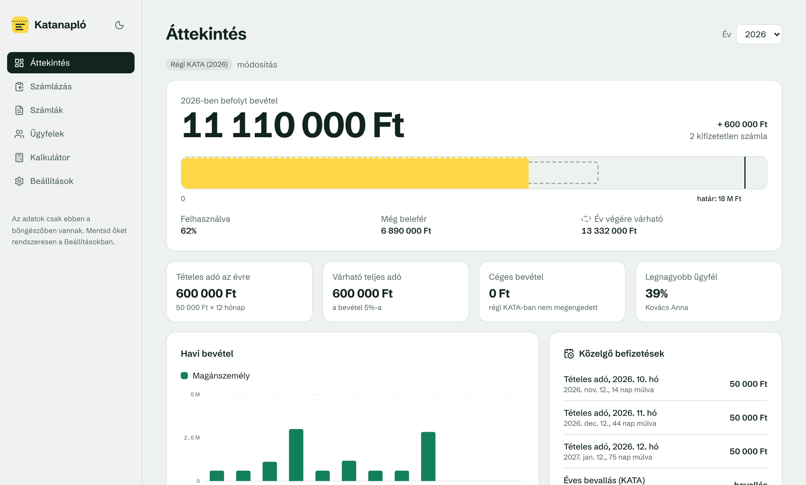
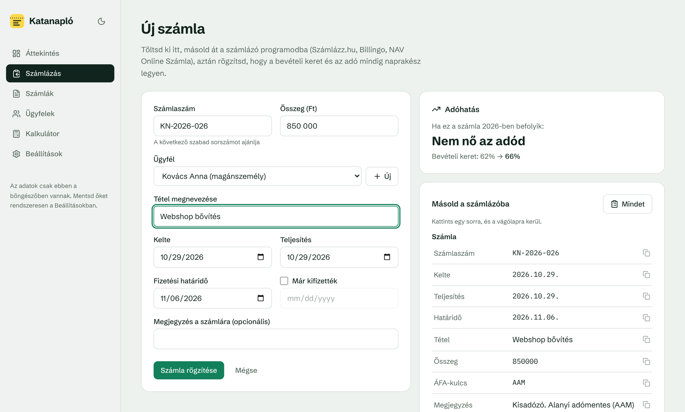
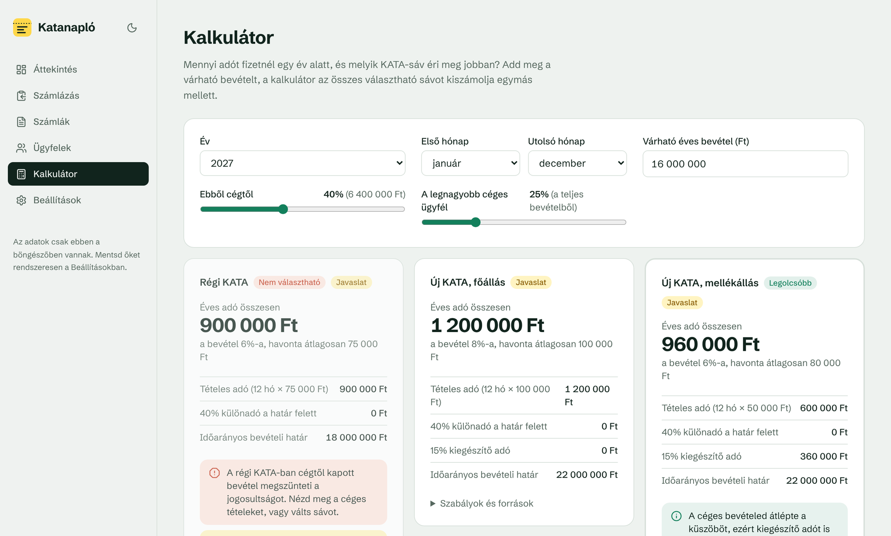
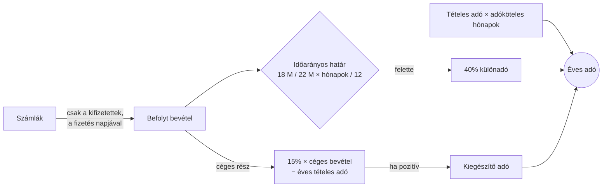

<div align="center">


# Katanapló

**Számlanyilvántartás és adókalkulátor kisadózóknak, a 2027-es új KATA szabályaival.**

Rögzítsd a számláidat, és mindig látod, mennyi fér még bele a bevételi keretbe,
mennyi adó jön, és mikor kell fizetni.

[**▶ Élő demó**](https://mrwitch21.github.io/kata_naplo/) · [Funkciók](#funkciók) · [Szabályok](#a-kata-szabályai-a-kódban) · [Felépítés](#felépítés) · [Futtatás](#futtatás)


<picture>
  <source media="(prefers-color-scheme: dark)" srcset="docs/dashboard-dark.png" />
  
</picture>

</div>

---

> [!NOTE]
> **TL;DR (English):** A client-side React + TypeScript app for Hungarian _KATA_ sole traders. It tracks invoices,
> shows how much of the yearly revenue cap is used, previews the tax impact of an invoice _before_ you issue it,
> and compares the current and the proposed 2027 KATA regimes. The tax rules live in a small, versioned,
> unit-tested domain layer, so the UI never hard-codes a number.

## Miért?

2026 októberében a kormány benyújtotta az új KATA törvényjavaslatát. 2027-től visszajön a céges számlázás,
nő a bevételi határ, de megjelenik egy 15%-os kiegészítő adó, a régi KATA pedig átmeneti lesz. Egy kisadózónak
hirtelen három dolgot kell fejben tartania: **mennyi fér még a keretbe, mennyi adót fizet egy céges számla után,
és melyik sáv éri meg neki.**

A Katanapló erre épül. Nem számlázó program, hanem a számlázó mellé való napló: előkészíted benne a számlát,
egy kattintással átmásolod az adatokat a Számlázz.hu-ba vagy a Billingóba, rögzíted, és a keret meg az adó
azonnal frissül.

## Funkciók

<table>
<tr>
<td width="50%" valign="top">

### 🧾 Számlázás másolópanellel

A számla minden adata (számlaszám, dátumok, vevő, adószám, összeg, kötelező „Kisadózó” szöveg, AAM-kulcs)
**egy kattintással a vágólapra** kerül, egyenként vagy egyben. A következő szabad számlaszámot a saját
sablonod alapján ajánlja (pl. `KN-{YYYY}-{N}` → `KN-2026-026`).

</td>
<td width="50%" valign="top">

### 📈 Adóhatás a számla előtt

Mielőtt kiállítod, látod, mit okoz a számla: **mennyivel nő az éves adód**, és hány százalékra
ugrik a keret. Szól, ha átlépnéd a bevételi határt, a céges küszöböt, vagy ha egy megbízótól jönne a bevétel fele.

</td>
</tr>
<tr>
<td valign="top">

### 🟨 A bevételi keret „sárga csekkje”

Az időarányos bevételi határhoz mért befolyt bevétel, szaggatott vonallal az év végi becsléssel.
A KATA a **befolyt** bevétellel számol, ezért a fizetés napja számít, nem a számla kelte.

</td>
<td valign="top">

### 🧮 Sávkalkulátor

Régi KATA, új főállású és új mellékállású KATA **egymás mellett**, ugyanarra a bevételre.
Kiszűri azt a sávot, ami a bevételi összetételeddel nem választható.

</td>
</tr>
<tr>
<td valign="top">

### 📅 Határidők

A tételes adó (következő hónap 12.) és az éves bevallás, különadó, kiegészítő adó (február 25.)
határidői összeggel, napra pontosan.

</td>
<td valign="top">

### 🔒 Az adat a tiéd

Nincs szerver, nincs regisztráció. Minden a böngésződben marad. JSON-mentés és visszatöltés,
CSV-export a könyvelőnek, világos és sötét mód.

</td>
</tr>
</table>

<p align="center">
  
  
</p>

## A KATA szabályai a kódban

Minden szám egy helyen él: [`src/domain/rules.ts`](src/domain/rules.ts). A szabálykészletek évenként és sávonként
verziózottak, ezért ha a végleges törvény eltér a javaslattól, egy fájlt és a hozzá tartozó teszteket kell
frissíteni, a felülethez nem kell nyúlni.

|                         | Régi KATA<br/><sub>2026</sub> | Régi KATA, átmeneti<br/><sub>2027 / 2028</sub> | Új KATA, főállás<br/><sub>2027-től</sub>   | Új KATA, mellékállás<br/><sub>2027-től</sub> |
| ----------------------- | ----------------------------- | ---------------------------------------------- | ------------------------------------------ | -------------------------------------------- |
| **Havi tételes adó**    | 50 000 Ft                     | 75 000 / 100 000 Ft                            | 100 000 Ft → 2028-tól a minimálbér 31,5%-a | 50 000 Ft → 2028-tól a minimálbér 15%-a      |
| **Éves bevételi határ** | 18 M Ft                       | 18 M Ft                                        | 22 M Ft                                    | 22 M Ft                                      |
| **A határ felett**      | 40% különadó                  | 40% különadó                                   | 40% különadó                               | 40% különadó                                 |
| **Számlázás cégnek**    | ❌ megszűnik a jogosultság    | ❌                                             | ✅ 15% kiegészítő adó                      | ✅ 15% kiegészítő adó                        |
| **Céges küszöb**        | –                             | –                                              | ≈ 8 M Ft                                   | ≈ 4 M Ft                                     |
| **Egy megbízó**         | –                             | –                                              | 50% felett év végén megszűnik              | 50% felett év végén megszűnik                |
| **Állapot**             | hatályos                      | javaslat                                       | javaslat                                   | javaslat                                     |

A számítás menete:



A kiegészítő adó küszöbe nem egy beégetett szám, hanem az éves tételes adóból jön ki:
főállásban `12 × 100 000 / 0,15 = 8 000 000 Ft`. Ezért 2028-tól, amikor a tételes adó a minimálbérhez kötődik,
a küszöb magától követi.

## Felépítés

```
src/
├── domain/                 ← tiszta TypeScript, nincs benne React
│   ├── rules.ts            szabálykészletek évenként és sávonként
│   ├── calc.ts             éves számítás, év végi becslés, adóhatás, határidők
│   ├── invoiceNumber.ts    számlaszám-sablonok ({YYYY}, {YY}, {N})
│   └── *.test.ts           22 unit teszt, a cikkekben szereplő példákkal
├── store/
│   ├── schema.ts           Zod sémák: ezzel validál az import is
│   ├── store.ts            Zustand + localStorage persist
│   └── demo.ts             kitalált demóadatok, mindig az aktuális évre
├── components/             LimitMeter, MonthlyChart (saját SVG), CopyRow…
└── pages/                  Áttekintés, Számlázás, Számlák, Ügyfelek, Kalkulátor, Beállítások
```

Néhány döntés, és hogy miért:

- **A domain réteg nem tud a Reactről.** A `calculateYear()` egy tiszta függvény: beállítás és bevételi tételek
  be, eredmény ki. Ettől lehet unit tesztelni, és ugyanez hajtja a dashboardot, a kalkulátort és az adóhatás-előnézetet.
- **Az adóhatás két számítás különbsége.** A `marginalImpact()` kiszámolja az évet a számlával és nélküle.
  Nincs külön logika a határ- és küszöbátlépésekre, így nem is térhet el a fő számítástól.
- **Hash router és relatív `base`.** Statikus hostingon (GitHub Pages) is működik szerveroldali átirányítás nélkül.
- **Saját SVG-diagram.** Egy halmozott oszlopdiagramért nem éri meg egy diagramkönyvtár. A színeket
  színtévesztésre is validáltam, és a diagram táblázatként is megnyitható.
- **Zod a perzisztencia határán.** A visszatöltött mentés ugyanazon a sémán megy át, mint amiből a típusok jönnek.

## Futtatás

```bash
git clone https://github.com/MrWitch21/kata_naplo.git
cd kata_naplo
npm install
npm run dev        # http://localhost:5173
npm test           # Vitest
npm run build      # éles build a dist/ mappába
```

### Deploy

A repó tartalmaz egy GitHub Actions workflow-t, ami minden `main` pushnál lefuttatja a teszteket és kirakja az appot
GitHub Pagesre. Egyszer kell bekapcsolni: **Settings → Pages → Source: GitHub Actions**.

Vercelen és Netlifyn nincs teendő: a Vite presetet felismerik, a kimenet a `dist/` mappa.

## Ami még jöhet

- [ ] Átalányadó-összehasonlítás a kalkulátorban
- [ ] Számlázz.hu / Billingo API: a számla kiállítása közvetlenül az appból
- [ ] Opcionális szinkron több eszköz között (Supabase, sorszintű jogosultsággal)
- [ ] A végleges 2027-es törvény átvezetése a kihirdetés után

## Licenc

[GNU AGPL-3.0](LICENSE). Szabadon használhatod, módosíthatod és továbbadhatod. Ha viszont a módosított változatot
szolgáltatásként mások számára elérhetővé teszed (például weboldalon futtatod), a forráskódját is közzé kell tenned
ugyanezzel a licenccel.

## Fontos

Ez tájékoztató eszköz, **nem adótanácsadás**. A 2027-től érvényes szabályok a 2026. október 27-én benyújtott
törvényjavaslaton alapulnak, és a Magyar Közlönyben való kihirdetésig változhatnak. Adózási döntés előtt kérdezd a
könyvelődet. A számításban egyszerűsítések vannak, például a mentes hónapok nem csökkentik az időarányos határt.

Források: [Biztos Döntés: a kibővített KATA szabályai 2027-től](https://biztosdontes.hu/cikkek/kata-szabalyai-2027),
[Bank360: KATA 2027 feltételek](https://bank360.hu/blog/kata-2027-feltetelek).

<div align="center">
<sub>Készítette <a href="https://github.com/MrWitch21">Gyönge Máté</a>, AGPL-3.0 licenccel</sub>
</div>
